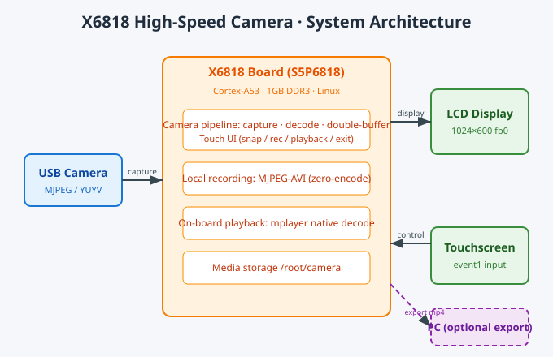
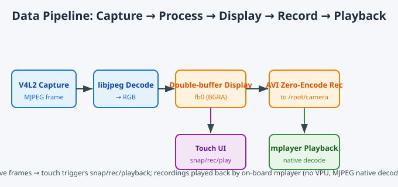

# X6818 High-Speed Camera Demo

A fully on-board, self-contained embedded camera system: USB camera capture → real-time decode to LCD → touchscreen-controlled snapshot / recording / playback / exit → zero-encode MJPEG-AVI local recording → on-board mplayer playback. **No PC/VM dependency, no WiFi backhaul** — the entire pipeline runs locally on the X6818 board. The app is started/stopped via on-screen touch buttons, and a single script brings everything back up after a power-cycle.

> Built for the "High-Speed Motion Camera Prototype v1.0" project (smart shopping cart scenario) on the X6818 (S5P6818 / Cortex-A53).

---

## Features

- **Fully on-board & self-contained** — capture, decode, display, record, playback all run locally on the board; no PC, no network.
- **Pure Linux user-space** — a single C file (`phone_view.c`, ~2000 lines), no ROS2 / OpenCV / X11 dependency.
- **Touchscreen UI** — four on-screen buttons: Snapshot / Record·Stop / Playback / Exit.
- **Zero-encode recording** — MJPEG frames are wrapped directly into AVI; no ffmpeg / x264 needed, recordable in real time.
- **On-board playback** — mplayer natively decodes MJPEG-AVI, bypassing the "no VPU" limitation (H.264 would show a black screen).
- **Double-buffered display** — off-screen buffer + per-frame memcpy to fb0, eliminating button flicker / tearing.
- **Reset-recoverable** — `mkdir /root/camera` on startup; `boot_cam.sh` brings up the whole stack with one command.

---

## System Architecture

### Overall



### Data Pipeline



---

## Directory Structure

```
X6818-Camera-Demo/
├── README.md                # This file (GitHub landing page)
├── LICENSE                  # MIT
├── .gitignore
├── src/
│   ├── phone_view.c         # Main app (capture/decode/display/UI/record/playback, single file)
│   ├── glyphs.h             # 32×32 CJK bitmap font (generated offline; no freetype on board)
│   └── Makefile             # Cross-compile (arm-linux-gcc)
├── scripts/
│   ├── boot_cam.sh          # On-board startup: sshd → create camera node → launch phone_view
│   ├── setup_cam.sh         # mknod camera node by real major:minor (board has no udev/mdev)
│   ├── install_to_board.sh  # VM → board flash (phone_view→/usr/bin, scripts→/root)
│   ├── transcode_avi.sh     # Optional: export AVI to H.264 mp4 (keeps original AVI)
│   └── backup_media.sh      # Optional: pack /root/camera media (does not delete originals)
├── docs/
│   ├── 技术说明.md           # Detailed technical doc (Chinese)
│   ├── architecture.svg      # System architecture diagram
│   └── pipeline.svg          # Data pipeline diagram
├── web/
│   └── camera_demo.html      # Web showcase page (Chinese, diagrams embedded)
└── tools/
    └── gen_docx.py           # Generate the Word version of the tech doc (python-docx, optional)
```

---

## Quick Start

### 1. Cross-compile (VM / Linux)

Requires `arm-linux-gcc 4.7.4` (crosstool-NG Linaro).

```bash
cd src
make clean && make          # produces ARM executable: phone_view
# Optional NEON acceleration: prepare libjpeg-turbo/lib/libjpeg.a first;
# the Makefile auto-prefers it when present.
```

### 2. Flash to board (VM → board)

Board rootfs is ext4 and persistent across resets.

```bash
cd scripts
bash install_to_board.sh <board-ip>
# phone_view → /usr/bin/phone_view, scripts → /root/*.sh
```

### 3. Update binary only (faster, if already flashed)

```bash
# On the board (serial / SSH)
killall phone_view

# On the VM (no space before the colon in scp)
scp ../src/phone_view root@<board-ip>:/usr/bin/phone_view

# After a board reset, just one command:
sh /root/boot_cam.sh
```

### 4. On-site demo (touchscreen)

1. Run `sh /root/boot_cam.sh` (serial or SSH) — brings up sshd, creates the camera node by real major:minor, launches phone_view.
2. LCD shows the live camera view with four bottom touch buttons: Snapshot / Record·Stop / Playback / Exit.
3. Tap **Record** to start, tap **Record·Stop** to stop — saved as `/root/camera/rec_*.avi`.
4. Tap **Snapshot** to save the current frame as a jpg into `/root/camera/`.
5. Tap **Playback** — on-board mplayer plays the latest recording (or shows the latest photo; touch anywhere to return).
6. Tap **Exit** for a clean shutdown of the process.

---

## Tech Stack & Protocols

| Layer | Protocol / Interface / Tech | Purpose |
|---|---|---|
| Capture | **V4L2** (Video4Linux2) + MJPEG | USB camera frame grab |
| Display | **Linux framebuffer** `/dev/fb0` (32bpp BGRA) | LCD live view |
| Decode | **libjpeg / libjpeg-turbo (NEON optional)** | MJPEG → RGB |
| Recording | **AVI (RIFF) container**, MJPEG zero-encode | Local video |
| Playback | **mplayer + fbdev2** (native MJPEG decode) | On-board playback |
| Touch UI | **Linux input subsystem** `/dev/input/event1` | Button hit-testing |
| CJK text | Offline 32×32 bitmap font `glyphs.h` | On-screen Chinese |
| Audio | **ALSA** `hw:0,0` (S16_LE) | Capture / playback |
| Networking | **WPA2-PSK** (`wpa_supplicant -Dwext`) + **SSH / SCP** | WiFi + file transfer |
| Build | Cross-compile `arm-linux-gcc 4.7.4` | ARM binary |

---

## Hardware Constraints & Highlights

- **No VPU → drop H.264** — the board has no hardware video decoder; the bundled mplayer soft-decoding H.264 shows a black screen. MJPEG-AVI native decode is used instead.
- **AVI index offset fix** — `dwOffset` baseline corrected to the `movi` data start (spec value), fixing old mplayer (1.0rc2) mis-seek that played only the beginning.
- **2-byte frame alignment** — frame padding follows the AVI 2-byte standard, compatible with the sequential read of the old mplayer.
- **No udev / mdev** — the board does not auto-create `/dev` nodes; `setup_cam.sh` does `mknod` by real major:minor and excludes display layers.
- **Zero-encode recording** — MJPEG frames wrapped straight into AVI; file is created only after the first frame arrives (no empty files).
- **Double-buffer anti-flicker** — off-screen buffer + per-frame memcpy removes button flicker under single buffering.

---

## Security Note

This repository **does not contain** any WiFi credentials / passwords. The `wake_ssh.sh` script (which connects to hotspots) is intentionally excluded from version control — manage network credentials via environment variables or a local untracked file to avoid leaking them.

---

## License

[MIT](LICENSE) © 2026 Huang Junlin (huojulin)
